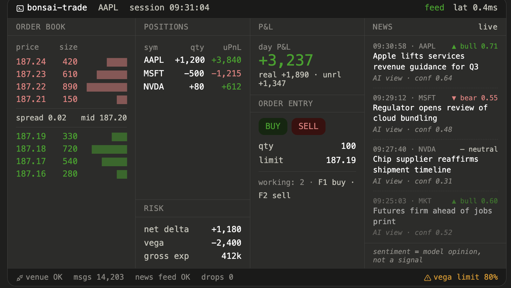

# Lucid Terminal

A real-time trading terminal built in OCaml. Streams live market data and news sentiment through Kafka into a matching engine, rendered as a full terminal dashboard.



## What It Does

- **Live order book** with real-time bid/ask updates from Finnhub WebSocket
- **Matching engine** that executes limit orders, tracks fills, and broadcasts trades
- **News sentiment scoring** via a LangGraph pipeline (Groq LLM) applied to financial headlines
- **Terminal UI** with four-panel layout: Order Book, Positions + Risk, P&L + Order Entry, News Feed
- **Custom DSL** for defining trading rules, parsed and evaluated within the engine
- **Simulator mode** for generating synthetic market data during off-hours

## Architecture

```
Finnhub WebSocket ──▶ Kafka ──▶ OCaml Engine ──TCP──▶ TUI
NewsAPI ──▶ Sentiment (LangGraph) ──▶ Kafka ──┘
```

| Component | Language | Role |
|---|---|---|
| **TUI** | OCaml (Bonsai) | Terminal dashboard — order book, positions, P&L, news, order entry |
| **Engine** | OCaml | Matching engine, order book management, DSL evaluator, TCP server |
| **Ingest** | Python | Finnhub WebSocket to Kafka (with off-hours simulator) |
| **Sentiment** | Python | NewsAPI headlines scored via LangGraph + Groq LLM |
| **Kafka Relay** | Python | Kafka consumer to TCP bridge for OCaml engine |
| **Kafka** | Docker | Apache Kafka 3.7.0 (KRaft, no Zookeeper) |

All inter-service communication uses newline-delimited JSON over TCP.

## Performance

| Metric | Value |
|---|---|
| Throughput | 1.6–1.8M orders/sec (single core) |
| p50 latency | ~410 ns |
| p99 latency | ~614 ns |
| p99.9 latency | 20–35 µs (GC tail) |
| Test coverage | 29 tests, 59 assertions |
| Kafka spike | Zero loss at 10x sustained traffic |

See [BENCHMARKS.md](BENCHMARKS.md) for methodology, machine specs, and GC analysis.

## Tech Stack

OCaml (OxCaml 5.2.0+ox), Bonsai_term, Dune, Apache Kafka 3.7.0 (KRaft), Python, Finnhub WebSocket API, confluent-kafka, NewsAPI, LangGraph, LangChain, Groq, Docker, Docker Compose v2

## Project Structure

```
tui/                        # Bonsai terminal UI
engine/
  bin/main.ml               # Engine entry point
  lib/
    matching_engine.ml       # Order matching logic
    order_book.ml            # Bid/ask book management
    dsl_lexer.ml             # DSL tokenizer
    dsl_parser.ml            # DSL parser
    dsl_eval.ml              # DSL evaluator
    engine_server.ml         # TCP server + message routing
    kafka_consumer.ml        # Kafka relay TCP client
    market_data.ml           # Market data types
    types.ml                 # Shared types
  services/
    ingest/                  # Finnhub WebSocket + simulator
    sentiment/               # NewsAPI + LangGraph scoring
    kafka_relay/             # Kafka → TCP bridge
  docker-compose.yml         # Full stack orchestration
docs/                        # Design documents
```

## Running

### Prerequisites

- Docker & Docker Compose v2
- OxCaml 5.2.0+ox (`opam switch`)
- API keys in `engine/.env`:
  ```
  FINNHUB_API_KEY=...
  NEWS_API_KEY=...
  GROQ_API_KEY=...
  ```

### Start the backend

```bash
cd engine
docker compose up -d
```

### Start the TUI

```bash
cd tui
eval $(opam env) && dune exec lucid_terminal
```

### Simulate market data (off-hours)

Set `INGEST_MODE=simulate` in `engine/.env`, then:

```bash
cd engine && docker compose up -d ingest
```

### Stop all services

```bash
cd engine && docker compose down -v
```
