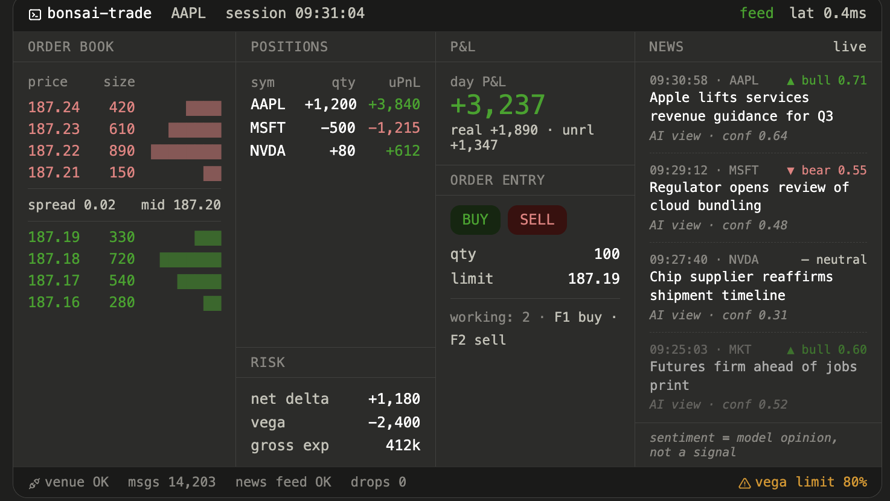

# Lucid TUI

The terminal dashboard running on top of Bonsai_term library. Frontend of lucid stystem app.

# Design

The dashboard design is shown below;


Explicit view of dashboard design

```
┌──────────────────────┬──────────────────────┬────────────────────┬──────────────────────────────┐
│ lucid-terminal  AAPL │ session 09:31:04     │                    │              feed  lat 0.4ms │
├──────────────────────┼──────────────────────┼────────────────────┼──────────────────────────────┤
│ ORDER BOOK           │ POSITIONS            │ P&L                │ NEWS                    live │
│                      │                      │                    │                              │
│ price    size        │ sym    qty    uPnL   │ day P&L            │ 09:30:58 · AAPL  ▲ bull 0.71 │
│ 187.24   420  ███    │ AAPL  +1,200 +3,840  │ +3,237             │ Apple lifts services         │
│ 187.23   610  █████  │ MSFT   -500  -1,215  │                    │ revenue guidance for Q3      │
│ 187.22   890  ██████ │ NVDA    +80    +612  │ real +1,890        │ AI view · conf 0.64          │
│ 187.21   150  █      │                      │ unrl +1,347        │                              │
│                      │                      │                    │ 09:29:12 · MSFT  ▼ bear 0.55 │
│ spread 0.02          │                      ├────────────────────┤ Regulator opens review of    │
│ mid 187.20           │                      │ ORDER ENTRY        │ cloud bundling               │
│                      │                      │                    │ AI view · conf 0.48          │
│ 187.19   330  ███    │                      │ [BUY]   [SELL]     │                              │
│ 187.18   720  █████  │                      │                    │ 09:27:40 · NVDA  — neutral   │
│ 187.17   540  ████   │                      │ qty      100       │ Chip supplier reaffirms      │
│ 187.16   280  ██     │                      │ limit    187.19    │ shipment timeline            │
│                      │                      │                    │ AI view · conf 0.31          │
│                      │                      │ working: 2         │                              │
│                      ├──────────────────────┤ F1 buy · F2 sell   │ 09:25:03 · MKT   ▲ bull 0.60 │
│ ◀ StreamOrderBook    │ RISK                 │                    │ Futures firm ahead of jobs   │
│                      │                      │ ▶ SubmitOrder      │ print                        │
│                      │ net delta   +1,180   │   (gRPC unary)     │ AI view · conf 0.52          │
│                      │ vega        -2,400   │                    │                              │
│                      │ gross exp     412k   │                    │ sentiment = model opinion,   │
│                      │                      │                    │ not a signal                 │
│                      │ ◀ StreamPositions     │ ◀ StreamTrades     │ ◀ StreamSentiment            │
├──────────────────────┴──────────────────────┴────────────────────┴──────────────────────────────┤
│ ᛘ venue OK   msgs 14,203   news feed OK   drops 0                      ⚠ vega limit 80%       │
└────────────────────────────────────────────────────────────────────────────────────────────────┘
```

# Components

## Top Bar

orienting context. The instrument you're focused on (AAPL), a session clock, and the health of your market data feed. That green "feed" dot and the 0.4ms latency number tell you the prices below are live and current. If the dot went red or latency spiked, you'd stop trusting everything on the screen — that's why it sits at the very top.

## Order Book

This is every resting buy and sell order in the market, stacked by price. The red rows on top are asks (people willing to sell), the green rows on the bottom are bids (people willing to buy). Price runs down the middle, size is how much is available at each price, and the bars on the right are just a visual sense of where the volume is concentrated. The dividing line in the middle shows the spread (0.02 — the gap between the best buy and best sell) and the mid price (187.20, roughly "fair" right now).

## Position

what you currently own. Each row is a symbol, how much you hold (+1,200 means long 1,200 shares; -500 means short), and the unrealized P&L on that holding — money you'd make or lose if you closed it right now at the current price. Green is winning, red is losing.

## Risk

your aggregate exposure, summed across everything. Net delta is your overall directional bet (how much you gain per $1 the market moves). Vega is your exposure to volatility. Gross exposure is total capital at risk. These are the numbers that tell you how much trouble you could be in if the market moves against you, regardless of which individual positions caused it.

## P&L

the scoreboard. Your total profit or loss for the day, split into realized (already locked in from closed trades) and unrealized (still open, could still swing). This is the single number most traders glance at most often.

## Order Entry

how you act. Consists of two actions (buy/sell), a quantity field, and a limit price field that a user types in. The user presses F1 to buy after typing in these values or F2 to Sell. The "Working: 2" means you have two orders resting in the market that haven't filled yet. The hotkeys (F1/F2/esc) reflect that real trading is keyboard-driven users don't have time to reach for a mouse.

## Bottom Bar

plumbing health. Confirmation your connection to the venue is alive, how many messages you've processed, whether any data was dropped, and risk-limit warnings. That amber "vega limit 80%" is a heads-up that you're approaching a preset ceiling on volatility exposure — a nudge to slow down before a system or risk manager stops you.

# Fixes to Accomodate Real Time Data Integration

[TO BE ADDED AFTER REAL TIME DATA INTEGRATION]
