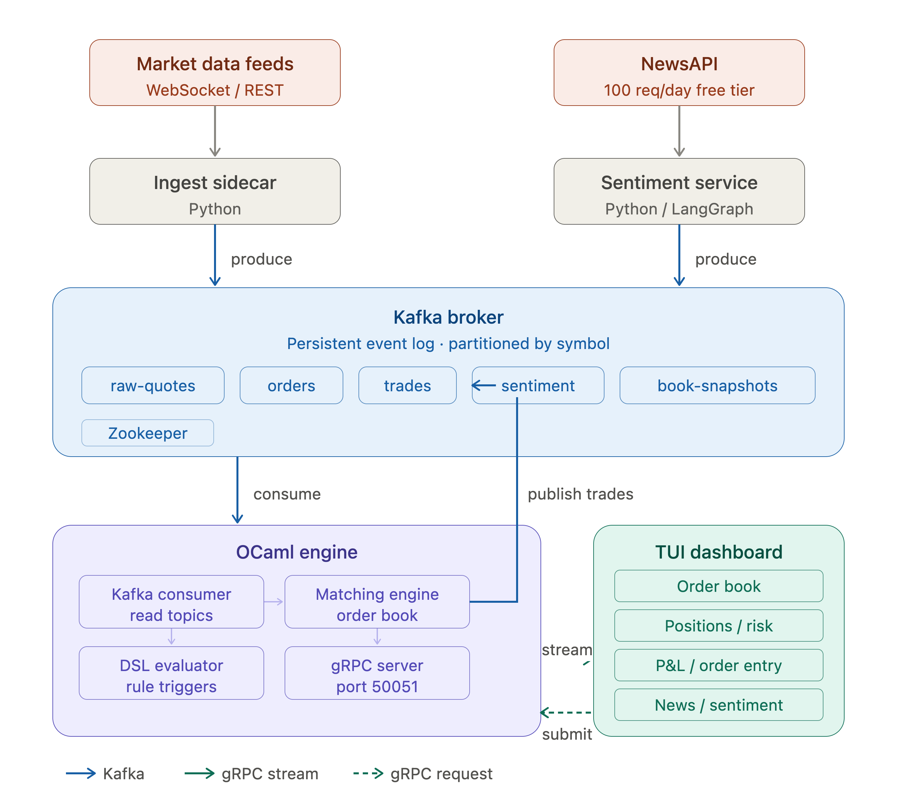

# Engine Real Time Data Streaming

## Using Kafka + TCP Instead of REST

**Kafka** is the central nervous system. Every event in the platform — a new quote, a submitted order, a completed trade, a sentiment score — is a message on a Kafka topic. Services don't talk to each other directly for data distribution; they publish to Kafka and consume from it. This means any service can be restarted, added, or removed without rewiring anything else. It also means every event is persisted and replayable, which is critical for debugging and auditing a trading system.

**TCP with newline-delimited JSON** is the direct line between the OCaml engine and the TUI. The dashboard needs a live, low-latency, bidirectional connection to the engine: it subscribes to order book updates (server → client stream) and sends user commands like manual order submissions (client → server calls). Since both the engine and TUI are OCaml in the same repo, they share types at compile time — stronger than protobuf contracts. A TCP socket with JSON framing keeps the protocol simple with zero extra dependencies (the OxCaml compiler's patched packages conflict with `grpc-eio`'s dependency chain, making gRPC impractical in this setup).

The rule of thumb: Kafka for "many services need this data," TCP for "one service is talking to one other service and needs a response."

## Architecture



## Data Flow — Step by Step
NOTE: TUI means Terminal User Interface

### 1. Market data enters the system

```
External Feed ──WebSocket──▶ Ingest Sidecar ──produce──▶ Kafka [raw-quotes]
```

The ingest sidecar is a lightweight Python process that connects to external market data APIs (WebSocket or polling), normalizes the data into a common quote format, and produces it to the `raw-quotes` Kafka topic. The sidecar handles reconnection, rate limiting, and format normalization so the OCaml engine never deals with external API quirks.

### 2. OCaml engine consumes quotes

```
Kafka [raw-quotes] ──consume──▶ OCaml Engine (market data handler)
                                       │
                                       ▼
                                Update internal price state
                                       │
                                       ▼
                                Evaluate DSL rules against new prices
                                       │
                                       ├──▶ If rule triggers: generate Order
                                       │         │
                                       │         ▼
                                       │    Matching Engine processes order
                                       │         │
                                       │         ▼
                                       │    Kafka [trades] ◀── trade results
                                       │
                                       ▼
                                TCP stream ──push──▶ TUI
```

The engine's Kafka consumer reads from `raw-quotes` in a tight loop. Each quote updates the engine's internal market state, which triggers DSL rule evaluation. If a rule fires (e.g., `WHEN price("AAPL") < 150.0 THEN buy(...)`), the resulting order is fed into the matching engine. Any trades that result are published to the `trades` topic.

Simultaneously, every time the order book changes, the engine pushes an `OrderBookUpdate` over the TCP stream to the connected TUI.

### 3. Sentiment flows in

```
NewsAPI ──poll──▶ Sentiment Service (LangGraph)
                        │
                        ▼
                  Analyze headline sentiment
                        │
                        ▼
                  Kafka [sentiment] ──consume──▶ OCaml Engine
                                                      │
                                                      ▼
                                                DSL can reference sentiment()
                                                      │
                                                      ▼
                                                TCP stream ──push──▶ TUI
```

The sentiment service polls NewsAPI on a schedule (respecting the 100 requests/day free tier — roughly once every 15 minutes), runs headlines through a LangGraph pipeline that scores them from -1.0 (bearish) to 1.0 (bullish), and publishes the scores to the `sentiment` Kafka topic. The OCaml engine consumes these scores and makes them available to the DSL evaluator. Scores are also forwarded over the TCP stream to the TUI for display.

### 4. TUI sends commands back

```
TUI ──TCP SubmitOrder──▶ OCaml Engine
                                │
                                ▼
                          Matching Engine
                                │
                                ▼
                          Kafka [trades] (if matched)
                                │
                                ▼
                          TCP stream ──push──▶ TUI (confirmation)
```

When a user manually submits an order through the TUI, it sends a `SubmitOrder` JSON message over the TCP connection. The engine processes the order through the matching engine. If it results in a trade, that trade is published to Kafka and also pushed back to the TUI over the TCP stream.

### 5. TUI initial sync

When the TUI first connects, it needs the current state of the order book, not just future deltas. The engine sends a full order book snapshot over the TCP connection on connect, then switches to streaming deltas for real-time updates.

### 6. How each TUI panel gets its data

Every panel in the TUI receives data exclusively through the TCP stream from the OCaml engine. The TUI never reads from Kafka directly. The engine acts as the single gateway between Kafka and the frontend. Each message is a JSON line with a `type` field to route it to the correct panel.

**Order book panel** — Receives `order_book_update` messages. Every time the engine's internal book changes (new quote consumed from Kafka `raw-quotes`, or an order matched), the engine pushes an update containing all bid/ask price levels, the spread, and the midpoint. The TUI renders this as the price ladder with size bars.

**Positions / risk panel** — Receives `position_update` messages. Whenever a fill updates the engine's inventory, it pushes the current positions (symbol, quantity, unrealized P&L) and risk metrics (net delta, vega, gross exposure). The TUI renders the positions table and risk section from this stream.

**P&L / order entry panel** — Receives `trade` messages for fill confirmations and day P&L updates. When the user submits an order via the BUY/SELL buttons (F1/F2), the TUI sends a `submit_order` JSON message over the TCP connection. The engine processes it through the matching engine, and if it fills, the trade confirmation arrives back on the stream. The working order count updates on the same stream.

**News / sentiment panel** — Receives `sentiment` messages. The sentiment service polls NewsAPI (~every 15 minutes on the free tier), scores each headline through LangGraph, and publishes to the Kafka `sentiment` topic. The engine consumes that topic and forwards each scored headline over the TCP stream. The TUI prepends new entries and pushes older ones down. Between polls the panel is static — "live" means latest available, not real-time.

## How Each Component Is Built

### Kafka broker

Runs as a Docker container using Bitnami's Kafka image in KRaft mode — no Zookeeper needed. No custom code — just configuration in `docker-compose.yml`. Topics are auto-created on first produce, or can be created via the `/opt/kafka/bin/kafka-topics.sh` CLI. An optional Kafka UI container is included for debugging at `http://localhost:8080`.

- Image: `apache/kafka:3.7.0` (KRaft mode, single-node)
- UI: `provectuslabs/kafka-ui:latest` (optional)

### Python ingest sidecar

A short Python script that opens a WebSocket connection to Finnhub (`wss://ws.finnhub.io`), subscribes to trade ticks for the symbols you're trading, normalizes each tick into a consistent JSON quote schema, and produces it to the `raw-quotes` Kafka topic. The free tier supports real-time streaming for up to 50 symbols at 60 API calls/min — no credit card required. The Kafka producer is handled entirely by the `confluent-kafka` Python package — you instantiate a `Producer`, call `produce()` with a topic and payload, and the library handles batching, compression, and delivery.

- Market data source: Finnhub free tier ([finnhub.io](https://finnhub.io)) — real-time US stock WebSocket stream
- WebSocket client: `websockets` (pip) — connects to `wss://ws.finnhub.io`
- Kafka client: `confluent-kafka` (pip)

If outside market hourse build or re-use an already built python script that performs as follows:

A small Python script that bypasses Finnhub entirely and produces fake quotes directly to the `raw-quotes` Kafka topic. This is the "dummy data first" approach from the project TODO and the most practical option for daily development — no external dependency, full control over the data.

The simulator should:

- Generate quotes for a configurable set of symbols (AAPL, MSFT, NVDA)
- Randomize prices around a base value with small drift (e.g., $187.00 ± $0.50)
- Vary volume realistically (100–1000 shares per tick)
- Publish at a configurable rate (e.g., 10–100 ticks/second)
- Optionally simulate edge cases: sudden price drops, wide spreads, volume spikes

```
Simulator (Python) ──produce──▶ Kafka [raw-quotes] ──consume──▶ OCaml Engine
```

The rest of the system — Kafka, the engine, the DSL, TCP streaming, the TUI — runs identically. The only difference is the source of the first message.

### Sentiment service

A Python service that polls NewsAPI for headlines related to the symbols you're trading, runs each headline through a LangGraph pipeline backed by Groq (`openai/gpt-oss-20b`) to produce a sentiment score (-1.0 to 1.0), and publishes the result to the `sentiment` Kafka topic using the same `confluent-kafka` producer. The LLM call and pipeline orchestration are handled by LangGraph and LangChain — you define nodes (fetch headlines → score sentiment → format output) and LangGraph manages the execution flow. Groq provides fast inference with generous free-tier rate limits.

- News source: `newsapi-python` (pip) — official Python client for NewsAPI.org
- Sentiment pipeline: `langgraph` + `langchain-groq` (pip) — LLM: `openai/gpt-oss-20b` via Groq

Inside the sentiment pipeline, apply these filters to avoid junk news from crowding our logs.

* NewsAPI query parameters: Don't just search for "Amazon." Use the category=business and lang=en filters on /v2/top-headlines and restrict sources to financial publishers.

* Classifier function as a gate: Before scoring, the classifier asks the LLM a cheaper question: "Is this headline about the publicly traded company Amazon (AMZN) in a financial context? Yes or no." That's a fast, low-token call. If it says no, the pipeline short-circuits and never calls the scorer. LangGraph If the headline classifier returns "not relevant," skip the next node.

- Kafka producer: `confluent-kafka` (pip)

### OCaml Kafka consumer (via Python relay)

The `ocaml-kafka` opam package requires OCaml < 5.0, which conflicts with the engine's OCaml 5.2 requirement. Instead, a lightweight **Python Kafka relay** sits between Kafka and the OCaml engine. The relay consumes from `raw-quotes` and `sentiment` topics and forwards messages over a TCP socket as newline-delimited JSON. The OCaml engine connects to this socket and reads messages using the `Unix` and `Yojson` modules (both already available, no new opam installs).

**Protocol:** Each line is a JSON object with a `topic` field to distinguish the source:
```json
{"topic":"raw-quotes","symbol":"AAPL","price":187.12,"volume":342,...}
{"topic":"sentiment","symbol":"AAPL","score":0.65,"headline":"...","reasoning":"..."}
```

**Components:**
- `services/kafka_relay/` — Python sidecar: `confluent-kafka` consumer → TCP server on port 9100
- `lib/kafka_consumer.ml` — OCaml client: connects to relay, parses JSON into `Quote` or `Sentiment` types
- OCaml dependencies: `yojson` (already installed), `unix` (already a dependency)

### TCP streaming layer (engine ↔ TUI)

The OCaml engine runs a TCP server. The TUI connects as a client. Communication is bidirectional over a single socket using newline-delimited JSON — one JSON object per line, each with a `type` field for routing.

Engine → TUI (server pushes):
- `{"type":"order_book_update", "bids":[...], "asks":[...], "spread":0.05, ...}`
- `{"type":"trade", "symbol":"AAPL", "price":187.50, "qty":100, ...}`
- `{"type":"position_update", "positions":[...], "pnl":1234.56, ...}`
- `{"type":"sentiment", "symbol":"AAPL", "headline":"...", "score":0.65, ...}`

TUI → Engine (client sends):
- `{"type":"submit_order", "symbol":"AAPL", "side":"BUY", "qty":100, "price":150.0}`

Since both sides are OCaml, the message types are shared at compile time via the `trading_engine` library — no code generation or schema files needed. The JSON serialization uses `yojson` (already installed).

- OCaml dependencies: `unix` (TCP sockets), `yojson` (JSON parsing) — both already available
- No new opam installs required
- Why not gRPC: the `grpc-eio` opam package conflicts with the OxCaml compiler's patched dependency chain (`h2 < 0.13.0` requires standard `ppx_deriving`/`eio`, which clash with the `+ox` patched versions)

### Docker Compose

All services are wired together in a single `docker-compose.yml`. Each service is a container on the same Docker network, so they can reference each other by service name (e.g., `kafka:29092`). No custom networking code — Docker handles service discovery.

- Containers: `kafka`, `kafka-ui`, `trading-engine`, `sentiment-service`
- Orchestration: `docker compose` v2

## Integration Summary
1. Phase 1: Kafka broker — Docker Compose with
Confluent Kafka + Zookeeper
2. Phase 2: Python ingest sidecar — Finnhub
WebSocket → Kafka raw-quotes
3. Phase 3: Sentiment service — NewsAPI →
LangGraph (Anthropic) → Kafka sentiment
4. Phase 4: OCaml Kafka consumer — ocaml-kafka,
consume raw-quotes + sentiment
5. Phase 5: TCP streaming layer — engine ↔ TUI
bidirectional JSON over TCP sockets
6. Phase 6: Docker Compose (full) — Wire all
services together

## Phase Verification Guide

How to confirm each phase is working before moving to the next.

### Phase 1: Kafka broker

**Start it** (from `engine/` directory):
```bash
docker compose up -d kafka kafka-ui
```

**Verify containers are healthy:**
```bash
docker compose ps
# kafka and kafka-ui should show "running"
```

**Check Kafka UI:**
Open `http://localhost:8080` in your browser. You should see the cluster dashboard with broker info.

**Create a test topic and round-trip a message:**
```bash
# Create a topic
docker compose exec kafka /opt/kafka/bin/kafka-topics.sh --create --topic test --bootstrap-server localhost:9092 --partitions 1 --replication-factor 1

# List topics to confirm
docker compose exec kafka /opt/kafka/bin/kafka-topics.sh --list --bootstrap-server localhost:9092
# Should include "test"

# In one terminal — start a consumer (will wait for messages):
docker compose exec kafka /opt/kafka/bin/kafka-console-consumer.sh --topic test --bootstrap-server localhost:9092 --from-beginning

# In another terminal — produce a message:
docker compose exec kafka /opt/kafka/bin/kafka-console-producer.sh --topic test --bootstrap-server localhost:9092
# Type a message and press Enter
```

**Pass criteria:** The message you typed in the producer terminal appears in the consumer terminal. The topic is also visible in the Kafka UI at `http://localhost:8080`.

### Phase 2: Python ingest sidecar

**Start it** (with Kafka already running from Phase 1):
```bash
docker compose up -d ingest
```

**Check logs for successful Finnhub connection:**
```bash
docker compose logs -f ingest
# Should show: WebSocket connected, subscribed to symbols
```

**Consume from raw-quotes to see live data:**
```bash
docker compose exec kafka kafka-console-consumer --topic raw-quotes --bootstrap-server localhost:9092 --from-beginning
```

**Pass criteria:** JSON quote messages appear in the consumer within a few seconds (during US market hours). Each message should contain fields like `symbol`, `price`, `volume`, `timestamp`. Outside market hours, you may see empty polls — that's normal for Finnhub's free tier.

Note: If outside market hours use the simulated data from Python script.

### Phase 3: Sentiment service

**Start it** (with Kafka already running):
```bash
docker compose up -d sentiment
```

**Check logs for successful NewsAPI poll:**
```bash
docker compose logs -f sentiment
# Should show: fetched N headlines, scored, published to Kafka
```

**Consume from the sentiment topic:**
```bash
docker compose exec kafka kafka-console-consumer --topic sentiment --bootstrap-server localhost:9092 --from-beginning
```

**Pass criteria:** JSON messages appear containing `symbol`, `headline`, `score` (a float between -1.0 and 1.0), and `timestamp`. The first batch should arrive within ~30 seconds of startup. Subsequent batches arrive every ~15 minutes.

### Phase 4: OCaml Kafka consumer (via relay)

**Start the relay** (with Kafka and ingest already running):
```bash
docker compose up -d kafka-relay ingest
```

**Verify the relay is receiving messages:**
```bash
docker compose logs kafka-relay
# Should show: "Relay listening on 0.0.0.0:9100" and "Subscribed to Kafka topics"
```

**Test the TCP stream from the host:**
```bash
nc localhost 9100 | head -5
```
You should see newline-delimited JSON with `"topic": "raw-quotes"` flowing.

**Build and run the OCaml engine** (connects to relay on localhost:9100):
```bash
cd engine && eval $(opam env) && dune build && dune exec main
```

**Pass criteria:** The engine connects to the relay and prints consumed quotes and sentiment scores as they arrive. The relay logs should show "Client connected".

### Phase 5: TCP streaming layer (engine ↔ TUI)

**Start the engine TCP server** (with Kafka pipeline and relay running):
```bash
cd engine && eval $(opam env) && dune build && dune exec main
# Should print: TCP server listening on 0.0.0.0:9200
```

**Test the stream with nc:**
```bash
# Connect and see order book updates streaming
nc localhost 9200 | head -5
# Should show JSON lines with "type":"order_book_update"

# Test submitting an order (in another terminal)
echo '{"type":"submit_order","symbol":"AAPL","side":"BUY","qty":100,"price":150.0}' | nc localhost 9200
```

**Pass criteria:**
- `nc localhost 9200` outputs JSON order book updates as they arrive
- Submitting an order returns a trade confirmation or acknowledgment
- Engine logs show "Client connected"

### Phase 6: Docker Compose (full stack)

**Start everything** (from `engine/` directory):
```bash
docker compose up -d
docker compose ps
# All containers should show "running": kafka, kafka-ui, ingest, sentiment-service, trading-engine
```

**Run the TUI and verify all panels are live:**
```bash
cd tui && eval $(opam env) && dune exec lucid_terminal
```

**Pass criteria (check each panel):**
- **Order Book** — Bid/ask levels update as quotes flow in
- **Positions / Risk** — Shows positions after a trade executes
- **P&L / Order Entry** — Can submit an order with F1/F2 and see fill confirmation
- **News / Sentiment** — Headlines with sentiment scores appear and refresh every ~15 minutes

**Teardown:**
```bash
docker compose down -v   # -v removes volumes for a clean slate
```

